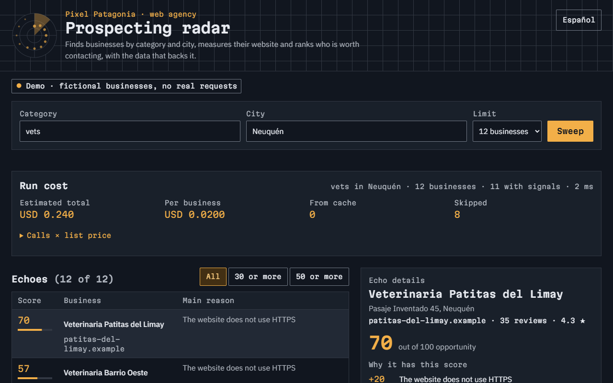
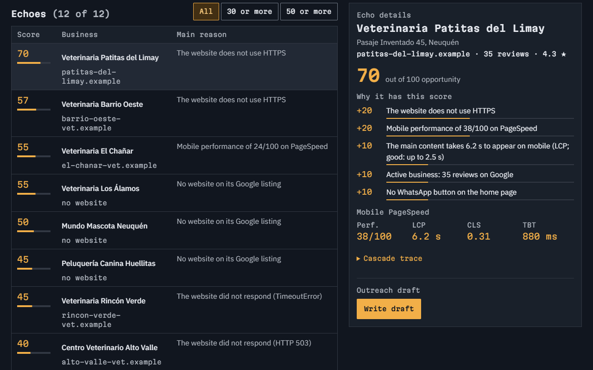
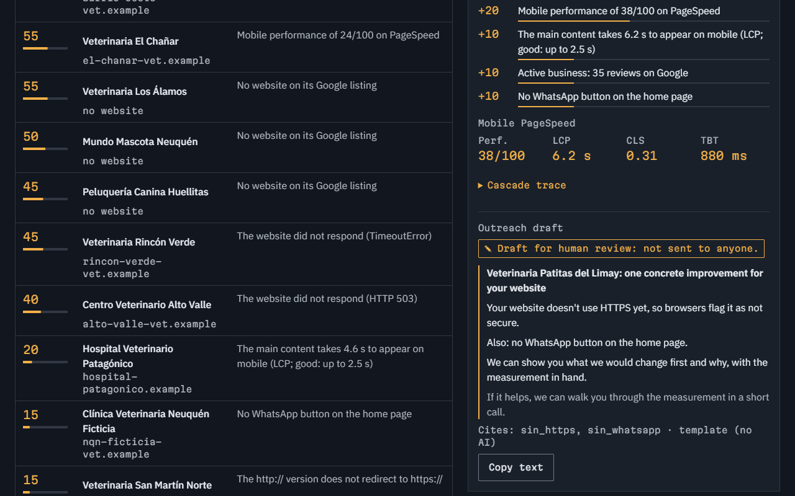
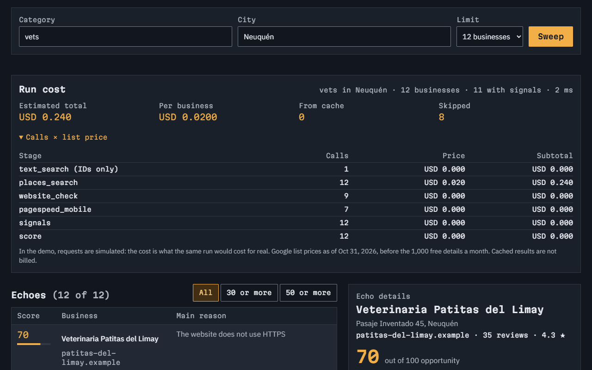
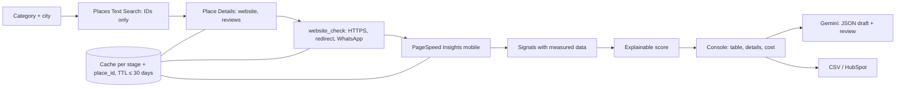

# Radar · Prospecting and enrichment for web agencies

Takes a business category and a city, finds the businesses with Places API (New), measures their website with
PageSpeed, detects opportunity signals, computes an explainable score and writes an outreach draft that is **never
sent**. Exports to CSV or HubSpot. · [Versión en español](README.md)


> **Demo project.** "Pixel Patagonia" is a fictional agency. The public demo uses 12 made-up vet clinics with `.example`
> domains (reserved, they don't exist). The live run in the metrics section was done once, locally, and its data was
> deleted before publishing. **No business was contacted.**

## The problem

A small web agency finds clients by reaching out to local businesses. Building the list by hand takes hours: search
Google Maps, open each website, check whether it loads fast, has HTTPS, has a WhatsApp button. And the first message
tends to be generic, because nobody wrote down what each business is missing. Tools like Clay solve this with an
"enrichment waterfall"; Radar is that waterfall, small and explainable, for one category and one city.

## The solution

- **Finds** businesses by category and city (Places API New, requesting IDs only: the no-cost SKU).
- **Enriches in a cascade:** business details → website check (HTTPS, redirect, WhatsApp button) → mobile PageSpeed →
  signals → score. Each stage is skipped when it makes no sense (no website means no PageSpeed; a Facebook or Instagram
  page is not measured) and leaves a trace: time, cost, cache, skip reason, retries.
- **Explainable score (0–100):** each signal adds fixed points and carries the measured data behind it ("Mobile
  performance of 38/100", "LCP of 6.2 s"). The same business always gets the same score.
- **Outreach draft** with Gemini (JSON validated with Zod): subject, 3 lines and a soft call to action. It can only use
  numbers that come from the signals, cannot promise results and is marked "Draft for human review". There is no send
  function or route.
- **Exports** to CSV (protected against formula injection) or HubSpot (company upsert by domain or name).
- **Web console** showing each run's cost (calls × list price per stage), in Spanish and English.

## Demo

- Live: https://radar-theta-roan.vercel.app/en (Spanish: https://radar-theta-roan.vercel.app). It's the demo with
  fictional businesses: no real requests and no cost.

| | |
|---|---|
|  |  |
|  |  |

## Architecture



- **Common interface** `Enricher {name, cost, ttlMs, saltear, run}`: adding a stage (for example, a data provider) means
  writing one more object, without touching the runner.
- **Runner:** limited concurrency across businesses, stages in order, retries with growing waits only on 429, 5xx or
  network errors. A 4xx is not retried and the business continues with what it has.
- **Cache** per stage + place_id with a mandatory TTL of 30 days at most (the code rejects a longer one). Running the
  same search again makes no requests to Google and costs nothing.
- **Two modes:** the demo (default, and on any deployment) uses the fictional businesses with no network. Live mode only
  opens with `npm run dev:real`, which listens on 127.0.0.1.

## Stack and skills shown

Clay-style enrichment pipeline · Google Places API (New) · PageSpeed Insights · Gemini structured output · HubSpot CRM
API · Next.js 16 · strict TypeScript · Tailwind 4 · Zod · Vitest · Playwright · axe-core · Lighthouse.

## How to run it

```bash
npm install
npm run dev                 # demo with fictional businesses → http://localhost:3204/en
npm run radar:seco          # the whole cascade in the terminal, with the fixtures
```

For live mode:

```bash
cp .env.example .env.local  # fill in GOOGLE_API_KEY (Places API New + PageSpeed) and GEMINI_API_KEY
npm run check-env           # OK/MISSING per variable, values never printed
npm run radar:real -- veterinarias Neuquén 15 3    # category, city, limit (≤ 20), drafts
npm run dev:real            # the console in live mode, this computer only
```

Set a budget alert in Google Cloud Billing before the first run.

## Tests and measured results

| Test | Result |
|---|---|
| Live run (Oct 31, 2026, 15 vet clinics in Neuquén, Argentina) | **33.4 businesses per minute** (27 s), **0 errors**, **15/15 with signals** (8 without a website, 6 with only social media, 1 with a 9.4 s LCP) |
| Cost of that run | **USD 0.02 per business** at list price (USD 0.30 total), within the free tier of 1,000 details a month |
| Same run from cache | **0 requests to Google, USD 0** |
| Gemini drafts (3.5 Flash-Lite) | **3/3 passed** the review (only measured numbers, no promises); ≈ 270 input and 120 output tokens each |
| Unit tests (`npm test`) | **29/29**: signals, deterministic score, cascade, cache and TTL, retries, concurrency, draft, CSV, HubSpot |
| e2e (`npm run test:e2e`, phone and desktop) | **14/14**: run, filter, details, draft with no send, CSV, simulated HubSpot, English, protected API |
| Accessibility (axe, WCAG 2.1 AA) | **0 violations** in 6 checks (Spanish and English) |
| Mobile Lighthouse (median of 3) on `/` and `/en` | **98 / 100 / 100 / 100** |

## Estimated running costs

| Item | Cost |
|---|---|
| Places Text Search (IDs only) | USD 0 |
| Place Details (website, reviews, rating) | USD 0.02 per business; the first 1,000 a month are free |
| Website check and PageSpeed Insights | USD 0 (PageSpeed has a free daily quota) |
| Draft with Gemini 3.5 Flash-Lite (paid tier) | ≈ USD 0.0004 per draft; USD 0 on the free tier, with a daily limit |
| Repeating a search within 30 days | USD 0 (cache) |

## Compliance

- **Google Maps Platform terms:** the only data stored without expiry is the `place_id`. All other Places content is
  used as a temporary cache that expires after 30 days at most (the code rejects a longer TTL). Check the current terms
  before any commercial use.
- **Business data only:** name, category, address, website, reviews and what was measured on the website. No people,
  emails or phone numbers, and no social media scraping: if a business's "website" is Facebook or Instagram, it is not
  visited.
- **Website visits:** one request to the home page and one to the `http://` version, with a user agent that identifies
  the tool.
- **Nothing is sent:** drafts are for human review and there is no send route. The HubSpot export is a simulation when
  no token is set.
- **Live-run data:** it stayed on the local computer (`data/cache/` and `data/corridas/` are outside git) and was deleted
  before publishing. The repository only contains the fictional fixtures.

## How I'd adapt it to Clay, Apollo or HubSpot

- **Clay:** each Radar stage is an enrichment column. Radar can be called from a Clay HTTP column (one endpoint per
  business that returns signals and score), or results can be pushed into a Clay table via webhook.
- **Apollo or another data provider:** it plugs in as one more stage (`Enricher`) with its own cost and TTL; the cascade
  decides when it's worth calling (for example, only for high-scoring businesses).
- **HubSpot:** the export already upserts the company. The next step is storing the score and signals in custom company
  properties and creating a task with the draft so someone reviews and sends it.

## Limits and next steps

- The score uses fixed, hand-picked weights; real reply data could tune them.
- The website check only looks at the home page.
- The public demo has a single sample search; live searches only run locally.
- Next steps: keep runs to compare over time, custom HubSpot properties and more signals (online booking, opening hours,
  listing photos).

## Author

Developed by Germán Schouabs.

## License

MIT. See [LICENSE](LICENSE).
