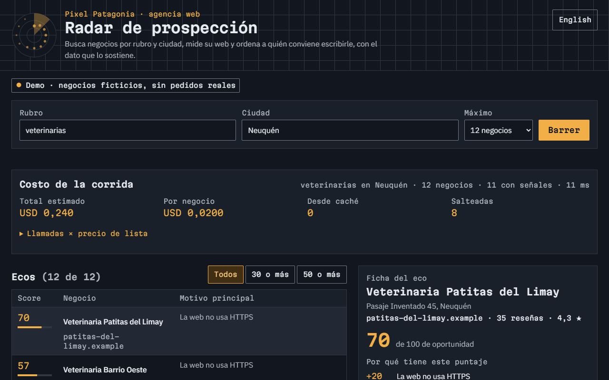
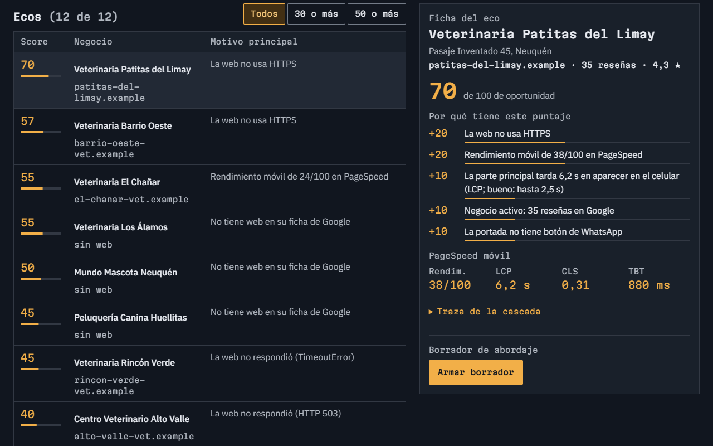
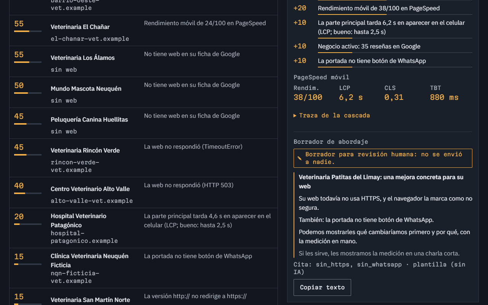
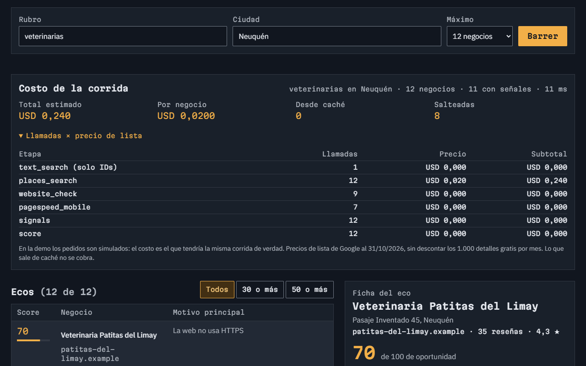
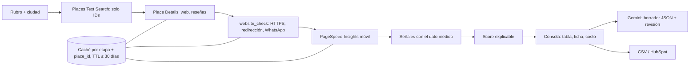

# Radar · Prospección y enriquecimiento para agencias web

Toma un rubro y una ciudad, busca los negocios con Places API (New), mide su web con PageSpeed, detecta señales de
oportunidad, calcula un puntaje explicable y arma un borrador de abordaje que **nunca se envía**. Exporta a CSV o a
HubSpot. · [English version](README.en.md)


> **Proyecto de demostración.** "Pixel Patagonia" es una agencia ficticia. La demo pública usa 12 veterinarias
> inventadas con dominios `.example` (reservados, no existen). La corrida real del apartado de métricas se hizo una vez,
> en local, y sus datos se borraron antes de publicar. **No se contactó a ningún negocio.**

## El problema

Una agencia web chica consigue clientes escribiéndoles a negocios de su ciudad. Armar la lista a mano lleva horas:
buscar en Google Maps, entrar a cada web, ver si carga rápido, si tiene HTTPS, si se puede escribir por WhatsApp. Y el
primer mensaje suele ser genérico, porque nadie anotó qué le falta a cada negocio. Herramientas como Clay resuelven esto
con una "cascada de enriquecimiento"; Radar es esa cascada, chica y explicable, para un rubro y una ciudad.

## La solución

- **Busca** negocios por rubro y ciudad (Places API New, pidiendo solo IDs: el SKU sin costo).
- **Enriquece en cascada:** detalle del negocio → revisión de la web (HTTPS, redirección, botón de WhatsApp) →
  PageSpeed móvil → señales → puntaje. Cada etapa se saltea si no tiene sentido (sin web no hay PageSpeed; una página
  de Facebook o Instagram no se mide) y deja su rastro: tiempo, costo, caché, motivo del salto, reintentos.
- **Puntaje explicable (0–100):** cada señal suma puntos fijos y lleva el dato medido que la sostiene ("Rendimiento
  móvil de 38/100", "LCP de 6,2 s"). El mismo negocio da siempre el mismo puntaje.
- **Borrador de abordaje** con Gemini (JSON validado con Zod): asunto, 3 líneas y un llamado suave. Solo puede usar
  números que salen de las señales, no puede prometer resultados y queda marcado "Borrador para revisión humana". No hay
  ninguna función ni ruta de envío.
- **Exporta** a CSV (protegido contra fórmulas) o a HubSpot (upsert de empresa por dominio o nombre).
- **Consola web** con el costo de cada corrida (llamadas × precio de lista por etapa), en español y en inglés.

## Demo

- En vivo: https://radar-theta-roan.vercel.app (en inglés: https://radar-theta-roan.vercel.app/en). Es la demo con
  negocios ficticios: no hace pedidos reales ni gasta nada.

| | |
|---|---|
|  |  |
|  |  |

Capturas en inglés en [`docs/capturas/en/`](docs/capturas/en/).

## Arquitectura



- **Interfaz común** `Enricher {name, cost, ttlMs, saltear, run}`: sumar una etapa (por ejemplo, un proveedor de datos)
  es escribir un objeto más, sin tocar el ejecutor.
- **Ejecutor:** concurrencia limitada entre negocios, etapas en orden, reintentos con espera creciente solo ante 429,
  5xx o red. Un 4xx no se reintenta y el negocio sigue con lo que tiene.
- **Caché** por etapa + place_id con TTL obligatorio de 30 días como máximo (el código rechaza uno mayor). La segunda
  corrida de la misma búsqueda no hace pedidos a Google ni cuesta nada.
- **Dos modos:** la demo (por defecto y en cualquier deploy) usa los negocios ficticios sin red. El modo real solo se
  abre con `npm run dev:real`, que escucha en 127.0.0.1.

## Stack y skills demostradas

Pipeline de enriquecimiento tipo Clay · Google Places API (New) · PageSpeed Insights · Gemini con salida estructurada ·
HubSpot CRM API · Next.js 16 · TypeScript estricto · Tailwind 4 · Zod · Vitest · Playwright · axe-core · Lighthouse.

## Cómo correrlo

```bash
npm install
npm run dev                 # demo con negocios ficticios → http://localhost:3204 (y /en)
npm run radar:seco          # la cascada completa en la terminal, con los fixtures
```

Para el modo real:

```bash
cp .env.example .env.local  # completar GOOGLE_API_KEY (Places API New + PageSpeed) y GEMINI_API_KEY
npm run check-env           # OK/FALTA por variable, sin mostrar valores
npm run radar:real -- veterinarias Neuquén 15 3    # rubro, ciudad, máximo (≤ 20), borradores
npm run dev:real            # la consola en modo real, solo en esta PC
```

Conviene poner un presupuesto con alerta en Google Cloud Billing antes de la primera corrida.

## Tests y resultados medidos

| Prueba | Resultado |
|---|---|
| Corrida real (31/10/2026, 15 veterinarias de Neuquén) | **33,4 negocios por minuto** (27 s), **0 errores**, **15/15 con señales** (8 sin web, 6 con solo redes sociales, 1 con LCP de 9,4 s) |
| Costo de esa corrida | **USD 0,02 por negocio** a precio de lista (USD 0,30 en total), dentro del cupo gratis de 1.000 detalles por mes |
| Misma corrida desde caché | **0 pedidos a Google, USD 0** |
| Borradores de Gemini (3.5 Flash-Lite) | **3/3 válidos** en la revisión (solo números medidos, sin promesas); ≈ 270 tokens de entrada y 120 de salida cada uno |
| Tests de unidad (`npm test`) | **29/29**: señales, score determinista, cascada, caché y TTL, reintentos, concurrencia, borrador, CSV, HubSpot |
| e2e (`npm run test:e2e`, celular y compu) | **14/14**: corrida, filtro, ficha, borrador sin envío, CSV, HubSpot simulado, inglés, API protegida |
| Accesibilidad (axe, WCAG 2.1 AA) | **0 violaciones** en 6 revisiones (español e inglés) |
| Lighthouse móvil (mediana de 3) en `/` y `/en` | **98 / 100 / 100 / 100** |

## Costos de operación estimados

| Concepto | Costo |
|---|---|
| Places Text Search (solo IDs) | USD 0 |
| Place Details (web, reseñas, rating) | USD 0,02 por negocio; los primeros 1.000 por mes, gratis |
| Revisión de la web y PageSpeed Insights | USD 0 (PageSpeed tiene cupo diario gratuito) |
| Borrador con Gemini 3.5 Flash-Lite (plan pago) | ≈ USD 0,0004 por borrador; en el plan gratis, USD 0 con límite diario |
| Repetir una búsqueda dentro de los 30 días | USD 0 (caché) |

## Cumplimiento

- **Términos de Google Maps Platform:** el único dato que se guarda sin vencimiento es el `place_id`. El resto del
  contenido de Places se usa como caché temporal que vence a los 30 días como máximo (el código no acepta un TTL mayor).
  Antes de un uso comercial, revisar los términos vigentes.
- **Solo datos de empresas:** nombre, rubro, dirección, web, reseñas y lo medido en su web. Nada de personas, emails ni
  teléfonos, y nada de scraping de redes sociales: si la "web" de un negocio es Facebook o Instagram, no se la visita.
- **Visitas a las webs:** un pedido a la portada y otro a la versión `http://`, con un user-agent que identifica la
  herramienta.
- **Nada se envía:** los borradores son para revisión humana y no existe ninguna ruta de envío. La exportación a
  HubSpot es una simulación si no hay token.
- **Datos de la corrida real:** quedaron solo en la PC (`data/cache/` y `data/corridas/` están fuera de git) y se
  borraron antes de publicar. El repositorio tiene solo los fixtures ficticios.

## Cómo lo adapto a Clay, Apollo o HubSpot

- **Clay:** cada etapa de Radar es una columna de enriquecimiento. Se puede llamar a Radar desde una columna HTTP de Clay
  (un endpoint por negocio que devuelve señales y puntaje) o mandar los resultados a una tabla de Clay por webhook.
- **Apollo u otro proveedor de datos:** se suma como una etapa más (`Enricher`) con su costo y su TTL; la cascada decide
  cuándo vale la pena llamarlo (por ejemplo, solo para los negocios con puntaje alto).
- **HubSpot:** el export ya hace upsert de la empresa. El siguiente paso es guardar el puntaje y las señales en
  propiedades propias de la empresa y crear una tarea con el borrador para que alguien lo revise y lo mande.

## Límites y próximos pasos

- El puntaje usa pesos fijos elegidos a mano; con datos de respuestas reales se podrían ajustar.
- La revisión de la web mira solo la portada.
- La demo pública tiene una sola búsqueda de ejemplo; las búsquedas reales corren solo en la PC.
- Próximos pasos: guardar las corridas para comparar en el tiempo, propiedades propias en HubSpot y más señales
  (reservas online, horarios cargados, fotos en la ficha).

## Autoría

Desarrollado por Germán Schouabs.

## Licencia

MIT. Ver [LICENSE](LICENSE).
